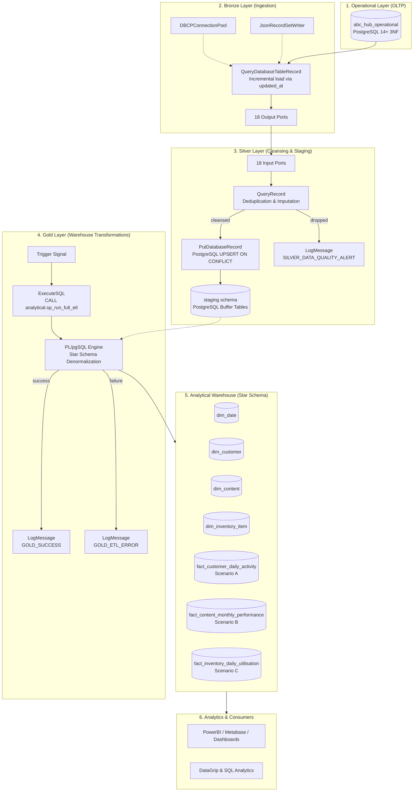
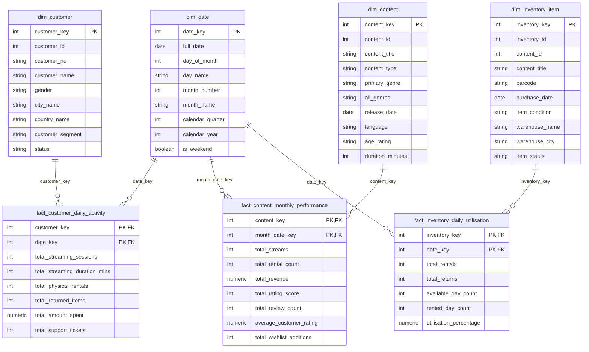

# ABC Hub End-to-End Data Engineering Platform 🚀
### Medallion Architecture ETL Pipeline & Analytical Dimensional Data Warehouse

[](https://nifi.apache.org/)
[](https://www.postgresql.org/)
[-brightgreen.svg)]()
[]()
[]()

---

## 📌 Executive Summary

**ABC Hub** is a hybrid digital media and physical logistics entertainment enterprise offering:
1. **Digital Streaming Platform:** On-demand digital movie/show streaming, customer subscriptions, and recommendation systems.
2. **Physical Rental Logistics:** Warehouse-managed physical media (DVDs/Blu-rays) dispatched via couriers, with doorstep delivery and returns.

This repository implements a production-grade, enterprise-scale **Data Engineering & Analytical Data Warehouse Solution** designed to extract raw operational data from a 3NF transactional database, cleanse and stage it using modern data-quality rules in **Apache NiFi**, and denormalize it into a high-performance **Kimball Star Schema Data Warehouse** in **PostgreSQL**.

---

## 🏗️ High-Level System Architecture

The solution follows the modern **Medallion Architecture (Lakehouse / Warehouse Pattern)** orchestrated across distinct Process Groups in **Apache NiFi 2.x**:



---

## 📐 Dimensional Data Warehouse Design (Kimball Methodology)

The analytical data warehouse is structured into **Three Star Schemas** answering specific business questions:

### 1. Business Scenarios & Grains

| Scenario | Target Star Schema | Granularity (Grain) | Business Justification |
| :--- | :--- | :--- | :--- |
| **Scenario A** | `fact_customer_daily_activity` | **One record per customer per calendar day** | Tracks omnichannel customer engagement across physical rentals, digital streams, financial spend, and support tickets. Enables daily churn early-warning and customer lifetime value (CLV) analysis. |
| **Scenario B** | `fact_content_monthly_performance` | **One record per content item per calendar month** | Measures catalog ROI, stream consumption velocity, customer ratings, rental revenue, and wishlist popularity to drive licensing and acquisition decisions. |
| **Scenario C** | `fact_inventory_daily_utilisation` | **One record per physical inventory item per calendar day** | Tracks physical asset velocity, dead stock, repair turnaround, warehouse utilization percentage, and equipment capital ROI. |

---

### 2. Star Schema Entity-Relationship Diagram



---

## ⚙️ Medallion Pipeline Engineering Deep Dive

### Layer 1: Bronze Layer (Raw Extraction)
- **Component:** Apache NiFi `QueryDatabaseTableRecord`
- **Source Database:** `jdbc:postgresql://localhost:5432/abc_hub_operational`
- **Extraction Strategy:** Incremental loading using `Maximum-value Columns: updated_at`. Tables without `updated_at` (e.g., lookup/mapping tables like `genre`, `content_type`, `content_genre`) use snapshot extraction.
- **Serialization:** `JsonRecordSetWriter` with ISO-8601 formatting for downstream stream safety.
- **Execution Mode:** Runs on `ALL` nodes for standalone compatibility.

### Layer 2: Silver Layer (Cleansing & Resilient Staging)
- **Component:** Apache NiFi `QueryRecord` & `PutDatabaseRecord`
- **Calcite SQL Cleansing Rules:**
  - `TRIM()` applied to strings (`first_name`, `last_name`, `title`, `city_name`).
  - Reserved keyword handling (`"language"` escaped in Calcite SQL).
  - Explicit decimal casting: `CAST(amount AS DOUBLE)` to prevent `NumberFormatException` in mixed-precision JSON payloads.
  - Imputation of missing/null values via `COALESCE`:
    - `COALESCE(gender, 'Unknown')`
    - `COALESCE(status, 'Active')`
    - `COALESCE(language, 'English')`
    - `COALESCE(age_rating, 'NR')`
    - `COALESCE(amount, 0.00)`
- **Resilient Staging Architecture:**
  - The PostgreSQL `staging` schema acts as an ingestion buffer. Date columns use resilient landing types (`VARCHAR(50)`) to seamlessly accept timestamps, epoch milliseconds, and ISO dates without JDBC type-conversion abortions.
  - Native **PostgreSQL UPSERT**: `Statement Type: UPSERT` with `Database Type: PostgreSQL` translates to `INSERT INTO ... ON CONFLICT (pk) DO UPDATE SET ...`, ensuring pipeline idempotence.

### Layer 3: Gold Layer (In-Database ELT Orchestration)
- **Stored Procedure:** `analytical.sp_run_full_etl()`
- **Wrapper Function:** `analytical.fn_run_full_etl()` returning a valid result-set for NiFi's `ExecuteSQL`.
- **Transformation Logic:**
  1. **Date Parsing:** Employs `analytical.fn_parse_date()` to dynamically parse both Unix epoch milliseconds and standard ISO date strings.
  2. **Denormalization:** Combines operational tables (e.g., `customer` + `customer_address` + `city` + `country` + `subscription_plan`) into single high-performance Dimension records.
  3. **Aggregations & Conflict Resolution:** Calculates daily and monthly metric aggregations using Common Table Expressions (CTEs) with strict `GROUP BY` deduplication to prevent PostgreSQL `ON CONFLICT DO UPDATE cannot affect row a second time` concurrency traps.

---

## 📂 Repository File Structure

```text
├── README.md                                         <- Master Documentation & Deployment Guide
├── DIMENSIONAL_MODEL_DESIGN.md                       <- Comprehensive Dimensional Modeling Specification
│
├── Assignment/
│   ├── DWDF Mini Project 01 ABC Hub v2 final.pdf     <- Assignment Specification Document
│   └── ABC Hub Data Package/
│       └── packages/
│           ├── ddl/
│           │   ├── operational_schema.sql            <- DDL for 18 OLTP Transactional Tables
│           │   ├── staging_schema.sql                <- DDL for Resilient Staging Schema
│           │   ├── analytical_schema.sql             <- DDL for Analytical Star Schema (Dims & Facts)
│           │   └── etl_transformations.sql           <- Stored Procedures & Date Generator
│           └── data/                                 <- Raw Source CSV Datasets (18 Tables)
│               ├── customer.csv
│               ├── rental.csv
│               ├── payment.csv
│               └── ... (15 more tables)
│
└── nifi_flows/
    ├── bronze_layer_flow.json                        <- NiFi Flow: Operational Extraction (18 Tables)
    ├── silver_layer_flow.json                        <- NiFi Flow: Data Cleansing & Staging Load
    └── gold_layer_flow.json                          <- NiFi Flow: Star Schema Warehouse Execution
```

---

## 🚀 Step-by-Step Deployment & Execution Guide

### Prerequisites
- **PostgreSQL 14+** running at `localhost:5432` (Superuser: `postgres`)
- **Apache NiFi 2.x** (Tested on `NiFi 2.12.0`)
- **PostgreSQL JDBC Driver:** `postgresql-42.7.x.jar` placed in `C:\nifi-2.12.0-bin\nifi-2.12.0\drivers\`
- **DataGrip / pgAdmin 4 / psql**

---

### Step 1: Initialize PostgreSQL Databases & Schemas

Open your SQL editor (e.g., DataGrip) and execute:

```sql
-- 1. Create Databases
CREATE DATABASE abc_hub_operational;
CREATE DATABASE abc_hub_analytical;
```

#### In `abc_hub_operational`:
Execute the operational schema to create all 18 transactional tables and import the CSV datasets:
```bash
psql -U postgres -d abc_hub_operational -f "Assignment/ABC Hub Data Package/packages/ddl/operational_schema.sql"
```

#### In `abc_hub_analytical`:
Execute the staging schema, analytical schema, and stored procedures:
```sql
-- Connect to abc_hub_analytical:
\c abc_hub_analytical

-- 1. Create Staging Schema & Tables
\i 'Assignment/ABC Hub Data Package/packages/ddl/staging_schema.sql'

-- 2. Create Analytical Schema, Dimensions & Facts
\i 'Assignment/ABC Hub Data Package/packages/ddl/analytical_schema.sql'

-- 3. Compile Helper Functions & Stored Procedures
\i 'Assignment/ABC Hub Data Package/packages/ddl/etl_transformations.sql'

-- 4. Pre-populate Conformed Date Dimension (2020-2030)
CALL analytical.sp_populate_dim_date(2020, 2030);
```

---

### Step 2: Configure & Start Apache NiFi 2.x

1. Start Apache NiFi:
   ```cmd
   cd C:\nifi-2.12.0-bin\nifi-2.12.0\bin
   run-nifi.bat
   ```
2. Open NiFi Canvas in browser: `https://localhost:8443/nifi` (or your configured port).
3. Import the flows:
   - Drag a **Process Group** icon onto the root canvas ➡️ Click **Browse / Upload**.
   - Import **`bronze_layer_flow.json`** ➡️ Name: `Bronze Layer`.
   - Import **`silver_layer_flow.json`** ➡️ Name: `Silver Layer`.
   - Import **`gold_layer_flow.json`** ➡️ Name: `Gold Layer`.
4. Enable Controller Services:
   - For each Process Group: Right-click ➡️ **Configure** ➡️ **Controller Services** ➡️ Click ⚡ **Enable** on:
     - `DBCPConnectionPool` (Validate password and JDBC JAR path).
     - `JsonRecordSetWriter`
     - `JsonTreeReader`
5. Connect Bronze to Silver:
   - Connect each of Bronze's 18 output ports to Silver's 18 input ports (e.g., `Customer_out` ➡️ `in_customer`).
6. Start Processors:
   - Start **Bronze Layer** ➡️ Extracted FlowFiles stream into Silver.
   - Start **Silver Layer** ➡️ Cleanses records and performs native PostgreSQL UPSERT into `staging.*`.
   - Start **Gold Layer** ➡️ Triggers `analytical.fn_run_full_etl()` to populate the Star Schema.

---

## 📊 Verification & Analytical Sample Queries

Once the pipeline finishes running, execute the following validation queries in `abc_hub_analytical` to inspect your dimensional warehouse:

### 1. Row Count Verification
```sql
SELECT 'staging.customer' AS table_name, COUNT(*) FROM staging.customer
UNION ALL
SELECT 'staging.rental', COUNT(*) FROM staging.rental
UNION ALL
SELECT 'staging.payment', COUNT(*) FROM staging.payment
UNION ALL
SELECT 'analytical.dim_customer', COUNT(*) FROM analytical.dim_customer
UNION ALL
SELECT 'analytical.dim_content', COUNT(*) FROM analytical.dim_content
UNION ALL
SELECT 'analytical.dim_inventory_item', COUNT(*) FROM analytical.dim_inventory_item
UNION ALL
SELECT 'analytical.fact_customer_daily_activity', COUNT(*) FROM analytical.fact_customer_daily_activity
UNION ALL
SELECT 'analytical.fact_content_monthly_performance', COUNT(*) FROM analytical.fact_content_monthly_performance
UNION ALL
SELECT 'analytical.fact_inventory_daily_utilisation', COUNT(*) FROM analytical.fact_inventory_daily_utilisation;
```

---

### 2. Scenario A Business Insight: Top 5 Active Customers
```sql
SELECT 
    c.customer_no,
    c.customer_name,
    c.customer_segment,
    SUM(f.total_streaming_sessions) AS total_streams,
    SUM(f.total_streaming_duration_mins) AS total_stream_minutes,
    SUM(f.total_physical_rentals) AS total_rentals,
    SUM(f.total_amount_spent) AS total_spent
FROM analytical.fact_customer_daily_activity f
JOIN analytical.dim_customer c ON f.customer_key = c.customer_key
GROUP BY c.customer_no, c.customer_name, c.customer_segment
ORDER BY total_spent DESC
LIMIT 5;
```

---

### 3. Scenario B Business Insight: Monthly Top Revenue Content
```sql
SELECT 
    d.calendar_year,
    d.month_name,
    c.content_title,
    c.primary_genre,
    f.total_streams,
    f.total_rental_count,
    f.total_revenue,
    f.average_customer_rating
FROM analytical.fact_content_monthly_performance f
JOIN analytical.dim_content c ON f.content_key = c.content_key
JOIN analytical.dim_date d ON f.month_date_key = d.date_key
ORDER BY f.total_revenue DESC
LIMIT 10;
```

---

### 4. Scenario C Business Insight: Warehouse Utilization Rate
```sql
SELECT 
    i.warehouse_name,
    i.warehouse_city,
    d.full_date,
    COUNT(f.inventory_key) AS total_tracked_items,
    SUM(f.total_rentals) AS total_rentals,
    ROUND(AVG(f.utilisation_percentage), 2) AS avg_utilisation_rate
FROM analytical.fact_inventory_daily_utilisation f
JOIN analytical.dim_inventory_item i ON f.inventory_key = i.inventory_key
JOIN analytical.dim_date d ON f.date_key = d.date_key
GROUP BY i.warehouse_name, i.warehouse_city, d.full_date
ORDER BY d.full_date DESC, avg_utilisation_rate DESC
LIMIT 10;
```

---

## 🛡️ Enterprise Robustness & Failure Recovery

| Potential Failure Mode | Pipeline Defensive Architecture |
| :--- | :--- |
| **Source Schema Drift / Nulls** | Handled in Silver `QueryRecord` via `COALESCE` defaults and column name normalization (`REMOVE_UNDERSCORE`). |
| **Calcite Decimal Conversion Crash** | Decimal columns explicitly cast via `CAST(amount AS DOUBLE)` to protect against Java `NumberFormatException`. |
| **Epoch Milliseconds in Staging** | Staging date attributes ingested as `VARCHAR(50)`, then converted dynamically by `analytical.fn_parse_date()` to avoid JDBC type abortions. |
| **Pipeline Re-run / Duplication** | Staging writes use native PostgreSQL `ON CONFLICT (id) DO UPDATE`. Fact tables use surrogate key pairs with idempotent UPSERT logic. |
| **NiFi Flow Serialization** | Flows exported strictly following Apache NiFi 2.x Versioned Component standards with full bundle metadata. |

---

## 👨‍💻 Author & Acknowledgements
- **Module:** Data Warehousing & Data Frameworks (DWDF) - Mini Project 01 / Capstone Project
- **Project Name:** ABC Hub Data Engineering & Analytical Platform
- **Methodology:** Medallion Architecture (Bronze/Silver/Gold) + Ralph Kimball Dimensional Modeling

---
*Developed with ❤️ for Advanced Enterprise Data Engineering.*

